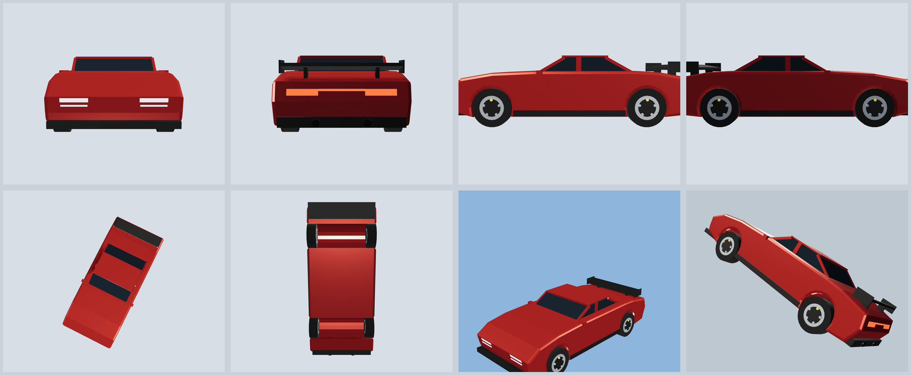

# Tyres, Not Tweens

A vehicle simulation where the car goes where the tyres push it — no authored
rotation, no authored velocity, no tweened root motion.



Three.js draws. Rapier integrates. Nothing writes a rotation or a velocity —
every frame, four contact patches compute a force from slip, apply that force at
the patch, and the chassis yaw/roll/pitch/trajectory fall out of the resulting
torque (`τ = r × F`). Steering is a joint angle. The throttle is an engine
torque. Braking is a brake torque.

**AI-generated** with OpenCode (primary model: DeepSeek V4.1 Flash) —
physics doctrine from the `fphysics-builder` skill.

---

## Run it

```bash
git clone https://github.com/UnixUserDev/tyres-not-tweens
cd tyres-not-tweens
python3 serve.py          # no-cache static server on 127.0.0.1:8099
# open http://127.0.0.1:8099
```

No install step is required — `vendor/` already contains three.js and Rapier.
`npm install` is only needed for `npm test` (node) and the optional single-file
build.

`serve.py` exists because `python3 -m http.server` sends no cache headers, so a
browser will happily run a cached `carModel.js` after a reload. This one sends
`no-store` on everything. The build tag in the HUD readout tells you which
version is actually running.

No build step, no bundler, no network: three.js and Rapier are vendored in
`vendor/` (Rapier's wasm is base64-inlined).

```bash
npm test              # 19 headless physics tests in node
npm run build:single  # optional: one self-contained HTML file in dist/
```

| Key | |
|---|---|
| `W` / `S` (or ↑ ↓) | throttle / brake. Hold `S` at a standstill (after driving) to engage reverse |
| `A` / `D` (or ← →) | steering |
| `Space` | handbrake — locks the rear wheels and parks the traction control, so it actually sets up a drift |
| `R` | reset car and furniture |
| `C` | camera: chase → hood → orbit (drag to orbit, wheel to zoom) |
| `F` | force-vector overlay |
| `T` | traction control on/off |
| `G` | drivetrain: RWD → AWD (40/60) → FWD |
| `B` | test map: playground → suspension → jumps → skidpad |
| `M` | mute (audio starts on your first key press or click) |
| `P` | pause |
| gamepad | left stick steers, RT/LT pedals, A handbrake |

The overlay (`F`) draws the actual force applied at each contact patch in red,
the suspension load in green, and the moment arm from the centre of mass to each
patch in blue. That is the whole mechanism, visible.

---

## Fidelity: level 3

| Level | Real | Faked |
|---|---|---|
| 0 | mesh | everything |
| 1 | gravity, collisions | yaw authored |
| 2 | raycast suspension, tire force at the patch | simple tire, no drivetrain |
| **3** | **slip-angle + slip-ratio tire model, four load-bearing patches, weight transfer, drivetrain torque** | **tire heat, aero detail** |
| 4 | thermal/wear, aero maps, flexible chassis | nothing meaningful |

### What is genuinely simulated

- **Yaw** — never assigned. It is `I_zz` integrating the sum of `r × F` from four
  contact patches. Steer a parked car and it turns the wheels only.
- **Longitudinal** — engine torque curve → clutch → gearbox → wheel torque →
  `ω` integrated from torque → slip ratio → tire force. The car accelerates
  because the tire pushes on the road, not because a speed variable was
  incremented.
- **Wheel spin** — `ω` is a state variable per wheel, solved implicitly each
  step against the tire's force curve. It is never `speed / radius`.
- **Load `Fz`** — four raycast springs, each with stiffness and damping, pushing
  on the chassis at the hub, plus anti-roll bars across each axle. Pitch and
  roll are the *difference between four spring forces*, so weight transfer under
  braking, acceleration and cornering is emergent, not a formula.
- **Cornering** — slip angle per wheel in its own steered frame, load-sensitive
  friction coefficient, combined-slip friction circle. Braking while turning
  runs wide because drive/brake force eats the same grip budget as cornering,
  and a spinning rear axle loses lateral grip instead of holding the car
  straight — which is what makes power oversteer and drifting possible at all.
- **Body attitude** — roll ≈ 2–3° at 0.85 g (roll stiffness from the springs on
  a 1.6 m track), pitch under braking, both integrated by Rapier's solver.
- **Aero** — drag `½ρCdAv²` and a little downforce, applied at an aero centre
  above the CoM so it produces a real pitch moment.

### Degrees of freedom audit

| DOF | Free? | Actuated by |
|---|---|---|
| chassis x / y / z | **free** | tire forces + springs + gravity |
| chassis yaw / pitch / roll | **free** | `Σ r × F` and the four spring forces |
| wheel spin ×4 | **free** | engine torque, brake torque, tire reaction torque |
| front wheel steer | constrained | **input (joint angle target)** |
| suspension travel | constrained | spring/damper vs the ground ray |
| engine rpm / gear | constrained | read off the drivetrain, shifts on its own |
| camera | authored | input — it only reads the body |
| reset | authored teleport | the `R` key |

### What is authored, and labelled as such

- **Chase/hood/orbit cameras** — cinematic, read-only.
- **Reset (`R`)** — `setTranslation` / `setLinvel(0)`. A teleport by definition.
- **Speed-sensitive steering** — the lock offered at speed is derived from the
  cornering radius the tyres could actually hold at that speed, not a linear
  taper, and the rack slows down as you go faster. It is applied to the
  *actuator* (the rack), never to yaw. Without it, a keyboard (which only has
  0 and 1) puts 26° of lock on at 60 km/h and the car spins on every tap.
- **ABS** — releases brake torque when a wheel's slip goes past −0.22. It trims
  a brake torque; it does not touch the wheel's speed or the car's velocity.
- **Traction control** (on by default, `T` to disable) — trims drive torque when
  the driven wheels pass 12 % slip. It is suppressed while the handbrake is
  pulled and for 1.2 s afterwards, otherwise it fights the drift the handbrake
  just started. Turn it off for a first-gear salute.
- **Auto gearbox** — shifts on the gearbox *shaft* speed (not the smoothed
  engine display), with a 0.16 s torque cut, a kickdown when you floor it in a
  tall gear, and no upshift while the driven wheels are spinning.
- **Drivetrain mode** (`G`) — RWD / AWD (40/60) / FWD. It changes which wheels
  receive torque and nothing else: the same engine, tyres and suspension, so
  RWD oversteers on power, AWD launches harder, FWD understeers as the front
  tyres spend their grip budget on drive.

### Known simplifications (level 3, not 4)

- Raycast suspension: one vertical spring per wheel against a ray. No camber
  curve, no toe, no anti-roll bar, no bushing compliance.
- Wheels are state, not rigid bodies: no unsprung mass, so a kerb hits the
  chassis with the tire's force but nothing rattles.
- The clutch is a torque model, not a slipping friction disc, and the crank
  speed while it slips is an estimate rather than an integrated DOF. Its inertia
  is lumped into the reflected powertrain inertia at the *driven* wheels only.
- Combined slip is one attenuation factor (`1 / (1 + 0.45|κ|)`) applied to the
  lateral force, not a full similarity-method tyre. It reproduces the collapse
  of sideways grip under wheelspin, which is the behaviour that matters here.
- Past peak slip the implicit wheel solve floors the force slope at 2 % of the
  rising slope. That is a numerical device, not physics: it makes a first-gear
  wheelspin settle instead of escalating into an infinite spin.
- Brake torque reaction on the chassis is not applied (it is an internal
  couple through the caliper → upright → suspension).
- One friction surface (dry asphalt, µ ≈ 1.0), no water, no temperature, no wear.
- No tire relaxation length: the force follows slip with a one-step lag only.
- Aero is a constant `CdA` / `ClA`, no yaw sensitivity, no ride-height effect.
- The body is a compound of five boxes (lower hull + greenhouse, nose cap, tail
  cap, wing) that follows the visible shell closely enough not to phase through
  the ground when it ends up on its roof. The lower hull is the only one that
  carries mass, so the extra shells cost nothing in inertia.

---

## Sound

There are no samples. Every sound is synthesised from the simulation's own state:

- **Engine** — the crank speed sets the firing frequency (rpm/60 × 3 for a V6,
  four-stroke) and four oscillators stack the harmonics; throttle opens a
  lowpass and adds intake rasp. Changing up drops the pitch because the wheels,
  not a sample player, decide the rpm.
- **Tyre squeal** — noise through two high, resonant bandpasses (~2.1 kHz and a
  ~3.3 kHz harmonic) plus a highpass. It is driven by the contact patches
  *sliding* (slip ratio and slip angle), not by grip utilisation: a clean full
  throttle launch sits at 100 % of available grip with the tread barely slipping
  and makes no noise at all, while a spinning or sliding tyre screams.
- **Suspension bang** — fired once, on the rising edge of the wheel bottoming
  out on its bump stop, which is the only moment something actually hits
  something. One bang per impact regardless of how many wheels hit together:
  a low 120→42 Hz body thump, a 30 ms metallic crack and a short triangle clank.
  A genuinely violent stroke (shaft speed > 4 m/s) counts as an impact too. It
  is deliberately not driven by shaft speed alone, which fires constantly over
  rough ground.
- **Wind** — noise through a lowpass, level with airspeed squared.

It starts on the first key press or click (browser autoplay rules), and `M`
mutes it.

## The car

The shell is a 2D side profile (with the wheel arches cut out of the outline)
extruded across the car, then a separate inset glasshouse, painted pillars, roof
panel and a wing with an angle of attack. 4.24 m long, 1.86 m wide, roof 1.22 m
off the ground on 0.66 m wheels. The wheel openings are cut 5.5 cm clear of the
tyres and the track is narrow enough that the wheels sit inside the bodywork
rather than poking through the flanks. The chassis collider is 1.84 m wide and
otherwise unrelated to any of it.

## Test maps (`B`)

The arena, walls and ground are shared; each map swaps the ramps and props and
puts the car back on its spawn.

- **playground** — the default: two 0.95 m humps, speed bumps, a slalom, a
  skidpad ring and some crates to hit.
- **suspension** — speed bumps of 6, 11, 17 and 24 cm, an 8-bump washboard, then
  a one-sided kerb so only the left wheels are loaded. Watch the per-corner
  loads and the body roll in the HUD; the ARB is doing the visible work.
- **jumps** — kickers of 0.45, 0.8, 1.15 and 1.5 m, spaced for landing runs.
  The car is genuinely airborne (all four raycasts miss) and lands on the
  bump stops.
- **skidpad** — open circle with a ring of cones, plus a cone slalom. For
  steady-state cornering and drift practice.

## HUD flags

| flag | means |
|---|---|
| `WHEELSPIN` | a driven wheel is turning faster than the road it is on |
| `LOCKUP` | a wheel is turning slower than the road (braking past the grip) |
| `SLIDE` | the body's velocity vector has diverged from its heading — a corner at the grip limit is *not* a slide |
| `AIRBORNE` | no wheel has contact |
| `HANDBRAKE` | handbrake held (also parks the TC) |
| `TC CUTTING` | traction control is trimming drive torque right now |

The two slip-based flags are direction-aware, because tyre slip is measured
along the car's forward axis: in reverse a locked wheel has the opposite sign,
and reversing points the velocity vector away from the nose, which otherwise
reads as a permanent slide.

## Two bugs worth remembering

- **The car could sink through the floor on its roof.** Only the lower hull had
  a collider, so the greenhouse, nose, tail and wing were pure decoration and
  the roof passed straight through the tarmac. Those are density-0 colliders
  now: mass and inertia are unchanged, but the car lands on its roof.
- **Wheel visuals lagged the body.** The wheels were positioned from
  `contact.center`, which the physics fills in *before* `world.step()`, while the
  body mesh is drawn from *after* it. One step of lag is `v·dt` — 20 cm at
  80 km/h, growing linearly with speed, which reads as "the wheels fall
  backwards". The wheels are now positioned in the body frame from the
  suspension travel, so they cannot lag by construction.
- **Suspension travel was 22 cm**, so hard cornering and landings dropped the
  wheels visibly out of their arches. Now 13 cm (±6.5 cm around static), which
  is a normal road car.

## Why the wheel solve is implicit

The tire is a very stiff spring between tread and rim. At 3.5 kN of load the
linearised slope of the magic formula is ~60 kN per unit slip ratio; against a
1.35 kg·m² wheel that is a 0.4 ms time constant — an order of magnitude faster
than the 8.3 ms physics step. Integrated explicitly, that loop diverges: a
*parked* car creeps away on numerical noise.

So each wheel is solved as `I·dω/dt = T − R·Fx(ω)` linearised about the current
slip and solved for the end-of-step `ω`, with the slope clamped at ≥ 0 (past the
peak grip is *falling*, and a negative stiffness in an implicit solve amplifies).
`I` includes the engine and gearbox reflected through the gear ratio — without
that a 1.35 kg·m² wheel spins up ~15× too fast and the car looks like it is made
of paper.

## Docs

- [`AGENTS.md`](AGENTS.md) — how to work in this repo: the rules, the two tests
  that gate every change, the traps (each one cost a debugging session).
- [`docs/physics.md`](docs/physics.md) — the model end to end with the actual
  numbers: per-step order, tyre curves, the implicit wheel solve, DOF table.
- [`docs/car-model.md`](docs/car-model.md) — the body recipe: extruded profile
  with cut arches, proportions, measure-before-you-place, wheels, env map.

## Files

```
index.html              import map, HUD markup
styles.css              dashboard
src/config.js           every tunable: mass, inertia, springs, gears, rubber
src/physics/tire.js     slip angle/ratio, magic-formula curves, friction circle
src/physics/drivetrain.js  engine curve, clutch, gearbox, reverse
src/physics/vehicle.js  the car: raycast suspension, patch forces, wheel solve
src/physics/sim.js      world, ground, ramps, walls, cones, crates (no rendering)
src/scene/track.js      asphalt, markings, ramps, props, skidmarks, lights
src/scene/carModel.js   cosmetic body: side profile extruded, arches cut out
src/ui/audio.js         procedural engine / tyre / wind sound
src/scene/forces.js     the force-vector overlay
src/ui/hud.js           dashboard
src/main.js             boot, input, fixed-timestep loop, cameras
tests/physics.test.mjs  headless physics tests
```

`src/physics/**` never imports three.js, so the identical physics runs in node.

## The tests

```
✔ rests on four contact patches with load summing to the car weight
✔ disconnect test: no torque means no motion
✔ parked steering turns the wheels, not the car
✔ steering in mid-air does nothing (yaw is not written)
✔ coast test: momentum and friction settle the car, not the input
✔ full throttle from rest spins the rear tyres (wheel omega is integrated)
✔ traction control keeps the driven wheels near their peak slip
✔ braking: grip circle saturates, the car stops, nothing reverses
✔ weight transfer is emergent: braking loads the front axle
✔ cornering rolls the body and loads the outside wheels
✔ stays finite through abuse: handbrake slides, kerbs, ramp, cones
✔ reverse needs a deliberate press, not just leaning on the brake
✔ ramp launches the car: all four wheels leave the ground
✔ steering points the car the way the player asked (both directions)
✔ steering assist keeps full keyboard lock from spinning the car
✔ handbrake sets up a drift you can hold on the throttle
```

The two severing tests from the doctrine are in there by name. If the car ever
gets a `transform.rotation.y += …` or a `velocity = inputDir * speed`, the
coast/disconnect/parked-steer tests fail.

Measured on this build, 1400 kg, 400 Nm, RWD, 6-speed: **0–100 km/h in 5.8 s**
(TC on), **100–0 in 43 m**, **0.8 g** sustained laterally, **2.1° of body roll**,
**~200 km/h and still pulling** at 18 s. Ride height 0.58 m, 26 cm of clearance
under the floor.

---

## License

MIT — see `LICENSE`.

**Everything here is AI-generated**: built with
[OpenCode](https://opencode.ai) (primary model: DeepSeek V4.1 Flash), following
the `fphysics-builder` skill's doctrine — input reaches actuators only, tyre
forces are applied at the contact patch, and yaw is integrated rather than
assigned.

The eight view renders in `docs/shots/` were captured from the sim itself with
the map and HUD hidden, not modelled separately.
